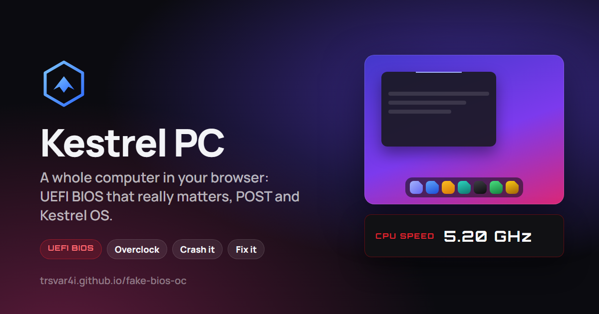

# Kestrel PC — целый компьютер в браузере



**Попробовать:** https://kestrel-pc.vercel.app — полная версия с классами (учитель, ученики, удалённое управление).
Копия без сервера: https://trsvar4i.github.io/fake-bios-oc/ — всё то же, кроме занятий с учителем. Ничего не нужно устанавливать, работает в браузере на компьютере и телефоне.

Kestrel PC — симулятор персонального компьютера от нажатия кнопки питания до рабочего стола: **POST → UEFI BIOS → загрузчик → собственная операционная система Kestrel OS**. Главная идея — железо и прошивка здесь не декорация. Каждая настройка BIOS меняет модель машины, а модель решает, как компьютер загрузится и как поведёт себя система: разгон без напряжения уронит ОС, тихие вентиляторы приведут к перегреву и сбросу частоты, выключенная сетевая карта оставит Магазин без интернета.

> Kestrel — вымышленный бренд. Проект не связан с производителями материнских плат и операционных систем; их интерфейсы служили только ориентиром по уровню детализации.

---

## Содержание

- [Что внутри](#что-внутри)
- [Как BIOS влияет на систему](#как-bios-влияет-на-систему)
- [Обучение и режим преподавателя](#обучение-и-режим-преподавателя)
- [Класс: учитель и ученики](#класс-учитель-и-ученики)
- [Испытания](#испытания)
- [Управление](#управление)
- [Как это устроено](#как-это-устроено)
- [Данные и приватность](#данные-и-приватность)
- [Разработка](#разработка)
- [Структура проекта](#структура-проекта)

---

## Что внутри

### Включение и POST
- Кнопка питания, щелчок реле и писк PC speaker — звук синтезируется на лету через Web Audio, без записанных файлов.
- Экран POST с логотипом: `DEL` — вход в BIOS, `F11` — меню загрузки.
- Строки POST честно показывают процессор, частоту шины, память с таймингами, накопители, состояние Secure Boot и CSM.

### UEFI BIOS
Два режима, как у современных плат:

**EZ Mode** — обзор на одном экране: частоты, температуры, напряжения, перетаскивание порядка загрузки, плитки быстрых переключателей (XMP, SVM, Secure Boot, сеть, звук…), обновление прошивки.

**Advanced Mode** (`F7`) — вкладки:

| Вкладка | Что там |
|---|---|
| My Favorites | самые используемые параметры в одном месте |
| Main | версия прошивки, EC/PSP, дата и время, язык |
| **Tweaker** | множитель, **BCLK**, **PBO**, **Load-Line Calibration**, порог троттлинга, Vcore и напряжение DRAM с подсказкой «сколько нужно», XMP, частота и тайминги памяти (tCL/tRCD/tRP/tRAS) |
| Advanced | SATA (AHCI/RAID), NVMe, встроенные сеть и звук, USB, виртуализация SVM, TPM |
| **Monitor** | графики температуры и оборотов за 90 секунд, напряжения линий питания, редактор кривой вентилятора Q-Fan, режим корпусных вентиляторов |
| Boot | порядок загрузки, **Launch CSM**, Fast Boot, Boot Override |
| **Tool** | **Instant Flash** (обновление прошивки с флешки), **6 профилей разгона**, SPD-информация памяти, **ссылка на конфигурацию** |
| Security | пароль администратора на вход в Setup, Secure Boot |
| Exit | сохранить и перезагрузить, отменить, загрузить заводские настройки |

Справа всегда живой Hardware Monitor. Внизу строка клавиш. Настройки хранятся в «CMOS» и переживают перезагрузку страницы. BIOS окрашен в цвет обоев рабочего стола и перекрашивается вместе с ними.

### Исходы загрузки
Обычная загрузка ОС, Live Linux с флешки, Secure Boot Violation, INACCESSIBLE_BOOT_DEVICE, «Reboot and Select proper Boot device», перегрев при старте, Overclocking Failed (POST не прошёл — автоматический откат), падение ОС от нестабильного разгона с предложением сбросить разгон.

### Kestrel OS
Собственный язык интерфейса — не macOS и не Windows: минимализм, воздух, плавные пружинные анимации.

- **«Насест» (Perch)** — парящая панель внизу: кнопка «Гнезда», закреплённые и запущенные программы (активная раскрывается в «пилюлю» с названием), Корзина, рабочие столы, сеть, звук, время, счётчик уведомлений.
- **«Хаб»** (`Alt+H`) — справа: плитки сети, «Не беспокоить», ночного света и темы; яркость, громкость, режим питания, музыка, таймер, уведомления.
- **«Гнездо»** (`Alt+L`) — все программы по разделам, поиск, учётная запись и питание (в том числе «Перезагрузить в BIOS»).
- **«Бросок»** (`Alt+Space`) — командная палитра: программы, файлы, калькулятор, команды системы.
- **Окна** — тонкая рамка, заголовок слева, «пилюля» управления справа; прилипание к краям с подсказкой; «Все окна» (`Alt+↑`); переключатель программ (`` Alt+` ``); несколько рабочих столов.
- **Виджеты** на рабочем столе: часы, календарь, напоминания, живая температура и частота процессора, заметки.
- **Экран блокировки** с паролем и несколькими пользователями (у каждого свои обои, файлы и настройки).
- Светлая, тёмная и автоматическая тема, ночной свет, шесть цветовых вариантов обоев — от них берётся акцент всего интерфейса и BIOS.
- Облегчённый режим для слабых устройств и поддержка системной настройки «уменьшить движение».

**Программы:** Файлы, Редактор, Заметки, Напоминания, Календарь, Калькулятор, Часы, Браузер, Терминал (zsh), Мониторинг, Kestrel VM, Настройки, Магазин, Обслуживание, Испытания. Из Магазина ставятся Рисовалка, Просмотр и Музыка (встроенный синтезатор с оригинальными треками).

Несколько деталей, которые делают систему живой:
- общая файловая система для Файлов, Терминала и рабочего стола, с Корзиной и перетаскиванием;
- Терминал понимает `ls`, `cd`, `mkdir`, `rm`, `mv`, `cat`, `echo > файл`, `sudo`, `ping`, `ifconfig`, `sensors`, `neofetch`, `stress`…;
- Kestrel VM запускает внутри окна гостевую систему со своим мини-POST: консольный Linux или маленький Kestrel внутри Kestrel;
- Браузер со встроенными страницами справки и истории изменений.

### Телефоны
Подсказка повернуть экран, экранные клавиши `DEL`/`F11`/`F7`/`F10`/`Esc` для POST и BIOS, долгое нажатие вместо правой кнопки, полноэкранный режим.

---

## Как BIOS влияет на систему

| Что сделать в BIOS | Что произойдёт |
|---|---|
| Поднять множитель (CPU Ratio) без напряжения | ОС загрузится и упадёт: экран паники ядра, перезагрузка, кнопка «сбросить разгон» |
| Сильно поднять множитель | POST не пройдёт — «Overclocking Failed», откат настроек |
| Поднять BCLK выше 103 МГц | процессор и память ускорятся, но ОС станет нестабильной; выше 104 МГц не пройдёт тренировка памяти |
| Включить XMP с низким напряжением DRAM или зажать тайминги | провал тренировки памяти |
| Load-Line Calibration | компенсирует недостающее напряжение под нагрузкой, но процессор греется сильнее |
| Тихий профиль вентиляторов + разгон | в системе процессор перегреется, частота сбросится (троттлинг), придёт уведомление |
| Выключить сетевой контроллер | в ОС нет сети: Магазин и Браузер офлайн, `ping` не работает |
| Выключить HD Audio | в ОС нет звука и музыки |
| Выключить SVM | Kestrel VM не запустится и подскажет, что включить |
| Secure Boot + флешка с Linux | Secure Boot Violation; с выключенным Secure Boot или включённым CSM — загрузится Live Linux |
| SATA в режим RAID | INACCESSIBLE_BOOT_DEVICE |
| Обновить прошивку (Instant Flash или из настроек ОС) | новая версия видна в POST, BIOS и «Об этом компьютере» |

И в обратную сторону: программы в ОС нагружают процессор, команда `stress` в Терминале загружает его полностью — температура и обороты вентиляторов в модели растут, а режим питания (Тихий / Баланс / Мощность) меняет частоту.

---

## Обучение и режим преподавателя

Kestrel PC можно использовать на уроках информатики: компьютер здесь можно разгонять, ломать и чинить без риска для настоящего.

### Уроки
Восемь пошаговых уроков с автоматической проверкой — от «что такое POST» до диагностики неисправностей:

| # | Урок | Уровень |
|---|---|---|
| 1 | Знакомство с BIOS: POST, вход в Setup, режимы EZ и Advanced, выход без сохранения | новичок |
| 2 | Порядок загрузки: Live Linux с флешки, разовое меню F11 | новичок |
| 3 | Secure Boot: почему не грузится неподписанный загрузчик, CSM, возврат защиты | средний |
| 4 | Разгон процессора: множитель, нехватка напряжения, сбой ОС, стабильная настройка | средний |
| 5 | Охлаждение и троттлинг: перегрев под `stress`, предел вентиляторов | средний |
| 6 | Память и XMP: провал тренировки памяти и нужное напряжение DRAM | средний |
| 7 | Диагностика: компьютер не загружается (INACCESSIBLE_BOOT_DEVICE) | продвинутый |
| 8 | Виртуализация: SVM в BIOS и гостевая система в Kestrel VM | продвинутый |

- Открыть уроки можно кнопкой **«Обучение»** на экране питания или программой «Обучение» в Kestrel OS.
- Карточка урока видна поверх любого экрана — POST, BIOS и ОС; её можно перетащить и свернуть. Шаг засчитывается сам, когда ученик сделал нужное (зашёл в BIOS, поменял параметр, уронил систему, загрузил Linux…). Есть подсказки и пропуск шага.
- В конце — короткий итог «что вы узнали» и кнопка «Следующий урок».
- Урок начинается с заводских настроек BIOS, а настройки ученика сохраняются: в конце их можно вернуть одной кнопкой.

### Случайные поломки
Тренировка диагностики на время — как смена в сервисном центре. Кнопка **«Начать смену»** вверху списка уроков.

- В смене 5 неисправностей из 12, без повторов и от простых к сложным: 2 лёгкие, 2 средние и одна сложная, где причин сразу две.
- Ученик видит только **жалобу клиента** («Магазин и Браузер пишут, что нет подключения. Кабель в порядке…»), а причину ищет сам. Иногда клиент ставит условие: «5 ГГц оставить», «защиту не выключать». Сброс BIOS к заводским настройкам такую поломку не засчитает.
- Компьютер сам перезагружается с новой неисправностью, а починка проверяется автоматически, как в уроках.
- **Очки:** 100 × сложность, плюс до 100 за скорость (бонус тает за 4 минуты), минус 40 за каждую из двух подсказок; минимум 10. Если сдаться, очков нет, но показывается разбор: что было сломано и почему.
- В конце — итоги смены по каждой поломке и личный рекорд.

Неисправности: SATA в RAID · выключена сетевая карта · выключен звук · флешка первой при Secure Boot · мало напряжения на CPU для 5 ГГц · мало напряжения памяти для XMP · перегрев (множитель 55 и тихие вентиляторы) · BCLK 103,5 МГц · выключена виртуализация · выключены USB-накопители и мешает Secure Boot · RAID + нет сети · нестабильный разгон + нет звука. Тесты проверяют, что каждая неисправность действительно ломает компьютер, а починка из подсказки его чинит.

### Задания от преподавателя
Сервер не нужен — всё работает через ссылку.

1. Преподаватель открывает «Обучение» → **«Преподавателю»**, выбирает поломку — диск в RAID, нестабильный разгон, память не проходит тренировку, Secure Boot не пускает, нет сети, нет звука, загрузить спасательную флешку, виртуальная лаборатория — или «свою поломку» (текущие настройки BIOS своего компьютера). Пишет название и пояснение, выбирает цель и получает ссылку.
2. Ученик открывает ссылку, вводит имя, и компьютер настраивается «сломанным». Цель проверяется автоматически.
3. Когда цель достигнута, ученик получает **код выполнения** вида `Y14-1DL`. Код зависит от задания и имени ученика.
4. Преподаватель на той же вкладке выбирает задание, вводит имя и код и видит «✓ Верно» или «✗ Не подходит».

Код вычисляется хешем без сервера, поэтому это защита от случайных ошибок и списывания «в лоб», а не криптографическая проверка.

## Класс: учитель и ученики

Полная версия (https://kestrel-pc.vercel.app) — система для уроков информатики: у учителя свой кабинет, ученики регистрируются сами и подключаются к классу по коду. Данные хранятся в базе Neon Postgres, сервер — функция Vercel.

### Роли
| Кто | Как появляется | Что может |
|---|---|---|
| **Администратор** (владелец сайта) | ключ `ADMIN_KEY` в настройках Vercel | создавать учителей, задавать им лимит учеников, менять пароли, удалять |
| **Учитель** | его создаёт администратор: логин, пароль, лимит учеников | кабинет `#teacher`: код класса, живые экраны учеников, удалённое управление, задания, результаты |
| **Ученик** | регистрируется сам в симуляторе: «Обучение» → «Мой класс» → «Регистрация», вводит код класса | получать и выполнять задания учителя; уроки и «Случайные поломки» засчитываются в журнал |

Учеников в классе не больше лимита, который задал администратор. Если мест нет, регистрация по коду не пройдёт. Учитель может сменить код класса (ученики, которые уже в классе, останутся), убрать ученика или задать ему новый пароль, если тот забыл.

### Кабинет учителя — https://kestrel-pc.vercel.app/#teacher
- **Код класса** крупно — его можно показать на проекторе.
- **Ученики — живые карточки** (обновляются каждые 4 секунды): в сети или нет, что сейчас на экране (выключен, POST, BIOS EZ/Advanced, ошибка загрузки с её названием, сбой ОС, рабочий стол и открытая программа), частота и температура процессора, текущий урок, задание или «поломки». Карточки с ошибкой подсвечиваются красным.
- **Удалённое управление** — для выбранных учеников (щёлкнуть по карточкам) или для всего класса:
  - сообщение на экран;
  - **заблокировать экраны** («Внимание на доску») и разблокировать; заблокированный компьютер не реагирует ни на мышь, ни на клавиатуру;
  - **выдать задание** — компьютер ученика сразу «ломается» и показывает карточку задания;
  - перезагрузить, выключить, сбросить BIOS к заводским настройкам.
- **Задания**: выбрать поломку (диск в RAID, нестабильный разгон, память, Secure Boot, сеть, звук, флешка, виртуализация), название, пояснение и цель. Полоса «выполнили N из M», архив.
- **Результаты**: таблица «ученик × уроки, рекорд поломок, задания» со временем выполнения.

Задание проверяется у ученика автоматически, а результат сам уходит учителю, без кодов.

### Администратор — https://kestrel-pc.vercel.app/#admin
Введите `ADMIN_KEY`, и откроется список учителей с формой «Новый учитель»: имя, логин, начальный пароль, лимит учеников. Ключ хранится только во вкладке браузера. Учителя можно создать и из консоли:

```bash
npm run teacher -- i.ivanova "Ирина Иванова" 30   # пароль спросит в консоли
```

### Безопасность
- Пароли хранятся как хеш scrypt со своей солью, сессия — случайный токен в cookie `HttpOnly; Secure; SameSite=Lax`, в базе только его SHA-256.
- После 8 неверных паролей за 15 минут вход для этого логина блокируется на время.
- Сервер принимает только JSON-запросы, поэтому форма на чужом сайте не может отправить команду от имени учителя.
- Учитель видит и управляет только своими учениками; ключ администратора сравнивается за постоянное время.
- Выполнение заданий сообщает компьютер ученика. Для учебного журнала этого достаточно, но это не экзамен с защитой от подделки.

## Испытания

17 целей для тех, кто хочет «сломать» компьютер осознанно. Прогресс сохраняется в браузере, а при выполнении поверх любого экрана — POST, BIOS или ОС — появляется значок.

Дойти до рабочего стола · зайти в UEFI Setup · 5 ГГц без сбоя · уронить систему разгоном · перегреть процессор · провалить тренировку памяти · загрузить Live Linux · получить Secure Boot Violation · получить INACCESSIBLE_BOOT_DEVICE · «Reboot and Select proper Boot device» · загрузиться без сети · запустить гостевую систему в VM · стресс-тест · обновить прошивку · сохранить профиль разгона · поставить пароль на BIOS · поделиться конфигурацией.

### Поделиться конфигурацией
BIOS → Tool → Share Configuration копирует ссылку вида `…/#cfg=…` с вашими настройками разгона, вентиляторов и загрузки (пароль и язык в неё не попадают). Открывший ссылку увидит список настроек и решит, применять ли их.

---

## Управление

| Где | Клавиши |
|---|---|
| Экран питания | `Enter` или `Space` — включить |
| POST | `DEL` — BIOS, `F11` — меню загрузки |
| BIOS | `F7` — EZ / Advanced, `F10` — сохранить и выйти, `F6` — заводские настройки, `F3` — избранное, `Esc` — назад, стрелки и `Enter` — навигация |
| Kestrel OS | `Alt+Space` — «Бросок», `Alt+L` — «Гнездо», `Alt+H` — «Хаб», `Alt+↑` — все окна, `` Alt+` `` — переключить программу, `Alt+←/→` и `Alt+1…6` — рабочие столы, `Alt+D` — показать стол, `Alt+W` — закрыть окно, `Alt+Q` — закрыть программу, `Alt+M` — свернуть, `Alt+Enter` — развернуть, `Alt+N` — новое окно, `Alt+Shift+N` — новая папка, `Alt+,` — настройки |

---

## Как это устроено

```
 кнопка питания
       │
       ▼
 ┌──────────┐   DEL    ┌──────────────┐   F10 (сохранить)
 │   POST   │ ───────► │  UEFI Setup  │ ──────────────────┐
 └──────────┘          └──────────────┘                   │
       │ (нет клавиш)                                     │
       ▼                                                  │
 ┌──────────────┐  исход загрузки по настройкам  ◄────────┘
 │  загрузчик   │ ──► ошибка / Live Linux / Kestrel OS
 └──────────────┘
                                   │
                                   ▼
                        ┌────────────────────┐
                        │     Kestrel OS     │ ◄── нагрузка, режим питания
                        └────────────────────┘          │
                                   ▲                    ▼
                                   └──── модель машины: температура,
                                         вентиляторы, частота, троттлинг
```

- **Модель машины** (`src/machine`) — единственный источник правды: параметры BIOS (`params.ts`), «железо» и прошивка (`hardware.ts`), тепловая модель с нагрузкой и троттлингом (`sensors.ts`), выбор исхода загрузки (`boot.ts`), испытания (`quests.ts`), профили и ссылки на конфигурацию (`profiles.ts`), звук (`audio.ts`).
- **BIOS** (`src/bios`) — экраны POST и Setup поверх этой модели.
- **Kestrel OS** (`src/os`) — оболочка, окна, файловая система, пользователи и программы; читает модель машины и пишет в неё нагрузку.
- Весь экран — фиксированная сцена 1920×1080, которая масштабируется под окно браузера, как настоящий монитор.

Стек: **Vite, React 18, TypeScript, zustand**. Без бэкенда: всё работает в браузере.

---

## Данные и приватность

Без входа в класс всё хранится только в `localStorage` вашего браузера, и на сервер ничего не отправляется. Если ученик вошёл в класс, раз в 5 секунд на сервер уходит состояние его компьютера (что на экране, частота, температура, текущий урок или задание) и прогресс уроков: это видит его учитель.

| Ключ | Что хранит |
|---|---|
| `kestrel.cmos` | настройки BIOS |
| `kestrel.fw` | установленная версия прошивки |
| `kestrel.ocprofiles` | профили разгона |
| `kestrel.quests` | прогресс испытаний |
| `kestrel.users`, `kestrel.user` | учётные записи и текущий пользователь |
| `kestrel.os`, `kestrel.os.<id>` | настройки пользователя (обои, пароль экрана блокировки, виджеты…) |
| `kestrel.fs`, `kestrel.fs.<id>` | файлы пользователя |
| `kestrel.lessons` | прогресс уроков, текущее задание, смена «Случайных поломок» и рекорд, резервная копия настроек BIOS |
| `kestrel.teacher` | задания, созданные преподавателем на этом компьютере |
| `kestrel.class` | выполняемое задание класса и блокировка экрана учителем |
| `kestrel.volume`, `kestrel.muted`, `kestrel.tour` | громкость, звук, показ знакомства |

Пароли экрана блокировки и BIOS — часть игры и хранятся в браузере в открытом виде: не используйте настоящие пароли. Чтобы начать с чистого листа, очистите данные сайта в браузере.

---

## Разработка

```bash
npm install
npm run dev      # http://localhost:8137
npm test         # vitest: модель машины, файловая система, интерфейс (jsdom)
npm run build    # проверка типов + сборка в dist/
npm run db:migrate   # создать таблицы класса в базе из DATABASE_URL
```

Для класса локально нужен `.env.local` с `DATABASE_URL` (строка подключения Neon, лучше отдельная ветка `dev`) и `ADMIN_KEY`. Dev-сервер Vite сам обслуживает `/api/*` тем же кодом, что и функция Vercel (`api/_lib/handler.ts`), — отдельный сервер не нужен.

**Публикация.**
- **Vercel** (полная версия с классом): репозиторий подключён к проекту, каждый пуш в `main` выкладывается автоматически (вручную — `vercel deploy --prod`). Переменные окружения проекта `kestrel-pc`: `DATABASE_URL` (ветка `main` в Neon) и `ADMIN_KEY`. Все `/api/*` переписываются на одну функцию `api/main.ts` (`vercel.json`).
- **GitHub Pages** (копия без сервера): каждый пуш в `main` запускает `.github/workflows/pages.yml`: тесты → сборка → выкладка. Сборка использует относительные пути (`base: "./"`), поэтому работает из любой подпапки.

**Тесты** (`npm test`):
- `src/machine/machine.test.ts` — исходы загрузки, CSM и Secure Boot, BCLK, LLC, тайминги памяти, разбор ссылки на конфигурацию;
- `src/os/os.test.ts` — файловая система, калькулятор, раскладка «Все окна»;
- `src/os/ui.test.tsx` — компоненты в jsdom: Калькулятор, Терминал (в том числе в React StrictMode), Магазин, перенос заметок;
- `api/_lib/api.test.ts` — сервер класса без базы: scrypt, cookie, коды классов, проверка полей, 404, только JSON, закрытые маршруты, ключ администратора, полный класс, блокировка перебора;
- `src/learn/learn.test.ts` — коды выполнения, ссылки-задания, прохождение урока по событиям и состоянию; «Случайные поломки»: каждая неисправность ломает ПК, починка из подсказки чинит, очки, ход смены.

**Добавить программу:** компонент в `src/os/apps/`, описание в `apps/meta.ts`, регистрация в `apps/index.ts`, стили рядом в `<App>.css`, иконка в `src/os/AppIcon.tsx`.

**Добавить параметр BIOS:** описание в `src/machine/params.ts`, место в меню `src/bios/setup/menus.ts`; если он должен влиять на поведение — учесть в `sensors.ts` или `boot.ts` и покрыть тестом в `machine.test.ts`.

---

## Структура проекта

```
api/
├── main.ts                      функция Vercel: все /api/* (vercel.json)
└── _lib/                        handler.ts — маршруты, auth.ts — пароли и сессии, schema.sql — таблицы
scripts/
├── migrate.mjs                  создать таблицы в Neon
└── teacher.mjs                  создать учителя из консоли
src/
├── main.tsx, App.tsx, app.css   точка входа: #teacher и #admin — кабинеты, иначе сцена 1920×1080 (питание → BIOS → ОС)
├── class/                       класс: API-клиент, синхронизация ученика и команды учителя (store.ts), «Мой класс» (ClassUi.tsx), кабинеты учителя и администратора (Portal.tsx)
├── Tour.tsx, Touch.tsx          знакомство при первом запуске, сенсорный слой для телефонов
├── QuestToast.tsx               значок выполненного испытания поверх любого экрана
├── learn/                       уроки (lessons.ts), задания преподавателя (tasks.ts), случайные поломки (drill.ts), прогресс и автопроверка (store.ts), карточка и окна (Learn.tsx)
├── machine/                     модель ПК: параметры, железо, сенсоры, загрузка, звук, испытания
├── bios/                        POST, Setup (EZ / Advanced), диалоги
│   ├── post/
│   ├── setup/
│   └── ui/
└── os/                          Kestrel OS: экраны, «Насест», окна, файлы, пользователи
    └── apps/                    программы (каждая со своим .css)
docs/
├── spec.md                      спецификация симулятора
├── os-design.md                 концепция ОС
└── night-report-2026-10-30.md   отчёт о большой переделке интерфейса
public/
├── og.png                       картинка для превью ссылки
└── favicon.svg
```

В папках `machine`, `bios`, `os` есть свои README с описанием файлов.
